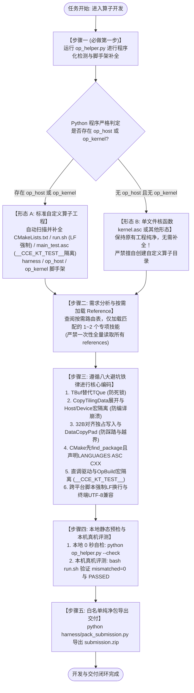

# 昇腾 Ascend C 算子全生命周期开发规范与工作流指南

本指南面向昇腾 **Ascend C 算子开发与高性能工程落地**（支持 CANN 8.0/9.0+，覆盖 910B/910C/950 等主流架构）。为了杜绝模型幻觉与上下文冗余，本技能确立了**标准化的双步骤驱动工作流**：

1. **核心铁律 1（工程形态由程序判定，严禁 AI 臆断）**：第一步**必须且优先运行** `op_helper.py`。通过 Python 程序检测当前目录下是否存在 `op_host` 或 `op_kernel`，若存在则自动补全自定义算子工程缺失的目录与文件；若不存在则**无需补全**，保持现有工程形态纯净。
2. **核心铁律 2（技能按需路由加载，严禁全量滥用）**：第二步进入算子开发时，**严禁一次性将所有 Skill / Reference 塞满上下文**！必须根据具体开发阶段与算子需求，在路由表中精准匹配并按需读取 `references/` 下的对应专项技能。

---

## 适用边界（先判断，再决定是否加载本 Skill）

### 适用

- 昇腾 Ascend C 单文件核函数（`kernel.asc`）的开发、调试、性能优化与验证。
- 标准自定义算子工程（`op_host/`、`op_kernel/`、`op_graph/`、`op_api/`）的开发、Tiling、测试与打包。
- CANN 8.x / 9.x，910B / 910C / 950 等昇腾平台上的算子问题。
- 需要把算子规格、数学公式或参考代码落成可编译、可验证的 Ascend C 实现。
- CUDA / CPU 算子迁移到 Ascend C 的方案分析与改造（走 `ascend-npu-migration`）。

### 不适用

- CUDA / GPU、ROCm、CPU-only 算子开发（除非任务明确是迁移到 Ascend 的前置分析）。
- 非昇腾平台的性能调优。
- 纯 Python / Web / 后端业务代码。
- 没有 Ascend C / CANN 上下文、也不打算在昇腾上运行的通用 C++ 问题。

如果任务不属于上述范围，直接说明「本 Skill 不适用」，不要强行套用算子模板或伪造 Ascend C 结论。

---

## 一、 算子开发标准工作流全景图



---

## 二、 步骤一（必做第一步）：执行 `op_helper.py` 程序化自检与补全

### 2.1 执行命令
在进入任何算子开发、重构或测试任务前，**首先在工程根目录执行**：
```powershell
# 方式 1: 直接在工程根目录下执行（若当前工作区已有 op_helper.py）:
python op_helper.py

# 方式 2: 通过技能库相对路径调用（兼容 Claude / DSH / Gemini / ModelScope 等运行环境）:
python <skill-dir>/scripts/op_helper.py
```

### 2.2 为什么必须由 Python 程序判断？为什么所有模板由 sampleproject 统一管理？
- **杜绝 AI 臆测**：AI 仅凭肉眼或少量 prompt 极易产生幻觉误判工程结构。
- **纯 Python 确定性执行**：本地脚本通过 `os.path.isdir("op_host") or os.path.isdir("op_kernel")` 进行 100% 确定性硬件/文件系统级判定。
- **单一真实数据源 (Single Source of Truth)**：脚手架涉及的所有模板文件（`CMakeLists.txt`, `run.sh`, `main_test.asc`, `op_host/*`, `op_kernel/*`, `harness/*`）**全部集中存放在 `references/sampleproject/` 物理目录中**。`op_helper.py` 仅负责二进制复制（保持天然 Unix LF 换行）或做简单的占位符变量替换，**严禁在 Python 脚本中内联写死任何 C++/Shell/CMake 多行字符串**，确保模板改动一处生效，杜绝多份冗余与版本漂移。

### 2.3 Python 脚本处理分支说明
- **分支 1：检测到 `op_host` 或 `op_kernel` 目录**
  - **判定形态**：标准自定义算子工程（Custom Operator Project）。
  - **自动补全清单（缺失则自动创建，存在则安全更新）**：
    1. `CMakeLists.txt`（顶级构建）：自动配置 `find_package(ASC REQUIRED)`、`project(... LANGUAGES ASC CXX)` 与 `test_op` 真机驱动目标；
    2. `run.sh`：自动生成本机评测驱动（**强制以 LF 换行保存**，支持 `npu` / `cpu` 两种模式）；
    3. `main_test.asc`：自动生成针对该算子名称的端到端 ACL 真机测试驱动（**内置 `#define __CCE_KT_TEST__` 宏隔离**）；
    4. `op_host/`：补齐 `CMakeLists.txt` 与 Host 侧 OpDef / TilingFunc 声明骨架；
    5. `op_kernel/`：补齐 `CMakeLists.txt`、`<op>_tiling.h`（**内置 Host/Device 宏兼容与 `CopyTilingData` 展开宏**）、`tiling_key_<op>.h`、`<op>.cpp`（带 `TBuf` 结构骨架）；
    6. `harness/`：补齐 `check_cleanliness.py`、`gen_golden.py`、`pack_submission.py`、`README.md`。
  - **执行 0 秒代码安全自检**：拦截非法 `printf`、`std::min/max`、包含宿主 `<iostream>` 等。

- **分支 2：当前目录下无 `op_host` 且无 `op_kernel` 目录**
  - **判定形态**：单文件核函数模式（如 `kernel.asc`）或其他独立工程形态。
  - **自动处理**：**无需补全！坚决不创建 `op_host`、`op_kernel`、`harness/` 等目录！** 保持单文件模式简洁纯净。
  - **安全自检**：若存在 `kernel.asc`，执行静态语法与毕昇 API 合规扫描，直接进入步骤二。

---

## 三、 步骤二：算子需求分析与精准按需加载 Reference 技能

> [!CAUTION]
> **铁律：禁止一次性全量加载所有 Reference 技能！**
> `references/` 下包含 **11 个专项子技能 + 5 份配套文档**，文档和代码极其丰富。如果全量读取，会导致上下文窗口严重臃肿，导致模型注意力漂移。**必须根据当前算子的具体阶段与核心需求，按表索骥，仅检索加载对应的 1~2 个专项文档！**

### 3.1 按需加载路由表 (Demand-Driven Skill Router)

| 序号 | 需求场景 / 开发环节 / 遇到的报错 | 对应专项技能 | 检索与读取路径 (相对路径) | 核心解决问题 |
|:---:|---|---|---|---|
| **1** | **核心矢量 API 真实签名与契约速查** | `ascendc-api-signatures` | `references/ascendc-api-signatures.md` | 【必查速查表】Sign / Power / Abs / Adds / Muls / Cast / DataCopyPad 真实签名与 Ext 参数 |
| **2** | **标准自定义算子工程规范与红线速查** | `ascendc-custom-op-rules` | `references/ascendc-custom-op-rules.md` | 【自定义算子必查】HOST-1~4 目录与校验红线、TilingData POD 契约、KERNEL-1~13 模板化派发与防死锁 |
| **3** | **官方单文件核函数标杆源码 (Flash 直调)** | `ops-direct-invoke-flash` | `references/ops-direct-invoke-flash/operators/` | 经典单文件 `add.asc` (910B通用)、`mul.asc` (950 Reg原生) 官方可运行标杆代码 |
| **4** | **官方 Kernel 直调全套工程模板** | `ascendc-direct-invoke-template` | `references/ascendc-direct-invoke-template/SKILL.md` | 官方标准直调脚手架、`add_custom` Vector 样例、PyTorch 桥接参考 |
| **5** | **算子算法模型与计算范式选型** | `ops-design-paradigms` | `references/ops-design-paradigms/SKILL.md` | 不确定算法属于逐元素、归约、广播、转置还是外积；选择最佳内/外循环与内存搬运拓扑 |
| **6** | **Tiling 多核切分与 UB 预算规划** | `ascendc-tiling-design` | `references/ascendc-tiling-design/SKILL.md` | 规划多核 BlockDim 负载均衡；Tail 尾块对齐处理；UB Buffer（$\le 160\text{KB}$）容量预算核算；32B 对齐切分 |
| **7** | **性能极致调优与流水线并行** | `ascendc-performance-best-practices` | `references/ascendc-performance-best-practices/SKILL.md` | 先 profiling 再优化；按 7 层顺序删无用工作、降搬运、改 locality、选执行单元、重叠、tiling、指令级微调 |
| **8** | **毕昇编译器约束与 API 合规避坑** | `ascendc-api-best-practices` | `references/ascendc-api-best-practices/SKILL.md` | 毕昇编译器报错；`__gm__` 跨空间限制；浮点强转整型报错；核内禁止调用 `<algorithm>` 的 `std::min/max` |
| **9** | **防死锁与同步审计 (300s卡死)** | `ascendc-sync-audit` | `references/ascendc-sync-audit/SKILL.md` | 程序运行 300 秒超时卡死；TQue 硬件队列死锁排查；PipeBarrier 正确插入时机；核内中间暂存强制使用 `TBuf` |
| **10** | **运行时崩溃、Trap 与段错误诊断** | `ascendc-crash-debug` | `references/ascendc-crash-debug/SKILL.md` | NPU 上报 Trap 异常、Core Dump、非法内存越界访问、非 32 字节对齐地址硬件硬报错定位 |
| **11** | **系统测试（ST）用例设计** | `ascendc-st-design` | `references/ascendc-st-design/SKILL.md` | 算子系统测试覆盖；L0 基础、L1 性能、L2 边界维度覆盖；构造素数形状与退化输入 |
| **12** | **白盒测试分支与边界极限分析** | `ascendc-whitebox-design` | `references/ascendc-whitebox-design/SKILL.md` | 极限 data_range、空 Tensor 容错测试、白盒代码执行分支 100% 覆盖 |
| **13** | **报错分诊与错误码速查** | `error-codes` | `references/error-codes.md` | EZ9999/GE/RTS/HCCL/AI_CPU/FE/Driver/AIC Error/OOM/hang/精度异常的快速分诊与首查清单 |
| **14** | **社区贡献、许可证头与目录规范** | `ascendc-contribution-rules` | `references/ascendc-contribution-rules.md` | 许可证头模板、op_host/op_kernel/op_graph/op_api 布局、def.cpp 注册、ACLNNType、提交前验证清单 |
| **15** | **CUDA / CPU 算子迁移到 Ascend C** | `ascend-npu-migration` | `references/ascend-npu-migration/SKILL.md` | 线程/内存/同步/数学 API 映射、迁移计划、风险清单与验证口径 |

> 模板工程 `references/sampleproject/` 由 `op_helper.py` 自动使用，不需要手动加载；本地编译、真机测试与打包说明见其 `harness/README.md`。
> 一次性生成 Prompt 模板放在 `references/prompt-templates.md`，只在「一次性生成完整代码」时读取。

---

## 四、 步骤三：遵循八大避坑铁律进行核心编码

在编码实现 AI Core 计算和 Host Tiling 时，必须牢记经过真机实战沉淀的**八大硬核防线**：

| 序号 | 踩坑现象 | 根本原因 | 最佳实践（已沉淀进模板） |
|:---:|---|---|---|
| **1** | **程序运行 300 秒超时卡死** | 深度为 1 的硬件队列 `TQue`，在循环内未 `FreeTensor` 便再次 `AllocTensor`，AI Core 硬件永久等待死锁。 | 核内临时暂存**强制使用 `TBuf`**（`pipe.InitBuffer` + `buf.Get<T>()`），零等待零死锁。 |
| **2** | **Host/Device 跨空间编译报错** | 1. `__gm__` 指针禁止跨地址空间隐式拷贝构造对象。<br/>2. Host 侧 CPU g++ 编译 `op_host` 时不认识 `__aicore__` 和 `__gm__` 报错。 | 在 `tiling.h` 顶部加保护宏：<br/>`#ifndef __aicore__ #define __aicore__ #endif`<br/>`#ifndef __gm__ #define __gm__ #endif`<br/>并使用 `CopyTilingData` 展开宏逐字段快速标量加载。 |
| **3** | **多核计算乱序、踩踏或非对齐越界** | 多核之间并发写入同一个 32B Cacheline（覆盖了彼此的有效数据），或非对齐尾部直接 DataCopy 越界写。 | 1. 多核切分必须以 32B 块（float 为 8 元素）为最小不可分割粒度，各自写入独占区间；<br/>2. 尾块非对齐读写**统一使用 `DataCopyPad`**，自动丢弃 dummy 避免越界写。 |
| **4** | **核内调用 Host 浮点库崩溃** | 在 AICore 核内调用 `std::pow`、`std::isinf`、`std::isnan`、`powf` 等，报 `candidate function not viable: call to __host__ function`。 | 1. 浮点分支一律在 Host 侧 `run_kernel` 计算好以 `int32_t p_mode` 标量下发；<br/>2. 核内矢量求幂使用 `AscendC::Power`；标量求幂可借 8 元素 UB 走 `Power`。 |
| **5** | **编译器报 kernel type 未标记警告** | `__global__` 函数未指定 `__vector__` 或 `__cube__`，毕昇编译器警告 `kernel type is not marked. auto type derivate may be failed`。 | 纯矢量核函数统一显式标注：`template <typename T> __global__ __vector__ void <op>_custom(...)`。 |
| **6** | **CMake 找不到 ASC 语言 Linker** | 1. 在 `find_package(ASC REQUIRED)` 之前先声明了 project；<br/>2. `project(xxx)` 漏写了 `LANGUAGES ASC CXX`，导致编译 `main_test.asc` 时报 `Cannot determine link language`。 | 严格保持先 `find_package(ASC REQUIRED)`，再执行 `project(xxx LANGUAGES ASC CXX)`。 |
| **7** | **直调 `main_test.asc` 与 OpBuild 宏冲突** | `main_test.asc` 直接包含核函数源码，导致毕昇编译 Device 代码时误引入 Host 专属的 `template_argument.h`，报 `printf` 冲突与 `tiling_data` 未声明。 | 1. `main_test.asc` 首行必须定义 `#define __CCE_KT_TEST__`；<br/>2. 核函数包含模板时加 `#ifndef __CCE_KT_TEST__` 保护；<br/>3. `tiling.h` 提供 `GET_TILING_DATA_WITH_STRUCT` 降级展开宏。 |
| **8** | **跨平台脚本执行与编码崩溃** | 1. Windows 下生成的 `run.sh` 带有 `\r\n` (CRLF)，Linux bash 报 `set: pipefail\r: invalid option name`；<br/>2. Windows GBK 终端运行 Python 客户端输出 Emoji 报 `UnicodeEncodeError`。 | 1. 写入 `run.sh` 时强制 `newline='\n'`（LF 换行）；<br/>2. Python 脚本开头统一注入 `sys.stdout.reconfigure(encoding="utf-8", errors="replace")`。 |

---

## 五、 步骤四：本地静态自检与本机真机评测

### 5.1 本地 0 秒静态代码自检
在修改完核函数后，随时在本地执行：
```powershell
python scripts/op_helper.py --check
```
- 0 秒拦截 AICore 核函数内非法调用的 `printf`、`std::cout`、`std::min/max`、`<iostream>` 等毕昇编译器无法链接的违规代码。

### 5.2 确认昇腾环境（由 AI 自行判断）
在编译前先确认当前环境是否具备昇腾开发条件：
```bash
npu-smi info                 # 能看到昇腾设备
echo "$ASCEND_HOME_PATH"     # 指向 CANN 安装目录
which bisheng || which ccec  # 能找到毕昇编译器
```
如果当前机器没有 NPU 或 CANN，由 AI 自行确认可用的昇腾机器、容器或云平台，并在该环境执行后续命令；本 Skill 不绑定任何具体平台，也不要假设任何固定的 IP、域名或评测服务，一切以当前环境的 `npu-smi` / `ASCEND_HOME_PATH` 为准。

> 若最终无法获得昇腾环境，按「未在真机验证」如实交付，写清楚缺失项；不要用静态检查冒充真机结论。

### 5.3 本机编译与真机评测
在工程根目录执行：
```bash
bash run.sh          # 默认 npu 模式
bash run.sh cpu      # 无 NPU 时做功能调试（前提是当前 CANN 支持 CPU 模式）
```
- `run.sh` 会完成 CMake 配置、编译和 `test_op` 执行。
- 确认终端输出 `mismatched=0` 与 `PASSED`。

---

## 六、 步骤五：白名单纯净包导出

当测试全部通过后，在工程根目录执行：
```bash
python harness/pack_submission.py
```
- 自动在当前目录生成 `submission.zip`；
- **白名单机制**：只收录 `CMakeLists.txt`、`README.md`、`kernel.asc` 或 `op_host/`、`op_kernel/` 下的核心源码；
- **自动剥离**：彻底剥离 `run.sh`、`main_test.asc`、`harness/`、编译中间目录以及测试数据，确保提交包无多余文件；
- 如需包含 `run.sh` / `main_test.asc` / `harness/` 的完整工程包，使用 `python harness/pack_submission.py --full`。

---

## 七、 完成定义（Definition of Done）

在向用户报告「完成」「已通过」「可以提交」之前，必须逐项确认；任何一项不满足都要明确说明：

- [ ] **工程形态**：已运行 `op_helper.py` 判定，未凭空创建/删除目录。
- [ ] **静态检查**：`python scripts/op_helper.py --check` 通过。
- [ ] **编译**：`bash run.sh`（或等价的 CMake/构建命令）通过，无未解释的警告/错误。
- [ ] **正确性**：参考输入输出比对通过，终端出现 `mismatched=0` 与 `PASSED`。
- [ ] **精度口径**：dtype、累加模式、ULP/相对误差、NaN/Inf 行为明确；fast/fallback 对相同输入一致。
- [ ] **代码红线**：无 `printf`/`std::cout`/`<iostream>`/`std::min`/`std::max`；TilingData 为 POD；GM 偏移字段为 `int64_t`。
- [ ] **对齐与同步**：多核按 32B 独占写入；尾块使用 `DataCopyPad`；Alloc/Free、EnQue/DeQue、跨核 flag 配对完整。
- [ ] **许可证**：如复用/修改第三方文件，保留原版权头并遵守其许可证。
- [ ] **未验证项**：如果当前环境没有 NPU/CANN，或没有运行 `run.sh`，必须写明「未在真机验证」以及具体缺失项；**禁止用静态检查代替真机结论**。

> 没有真机时的标准写法：「已完成静态检查与编译前检查；当前环境无昇腾 NPU/CANN，未执行真机 `run.sh`，因此 `mismatched=0`/`PASSED` 尚未验证。」

---

---

## 八、 一次性生成 Prompt 模板（按需加载）

当需要让 AI 一次性生成完整代码时，按任务类型读取：

- 单文件核函数（`kernel.asc`）：[references/prompt-templates.md](references/prompt-templates.md) 第一节。
- 标准自定义算子工程（`op_host` + `op_kernel`）：[references/prompt-templates.md](references/prompt-templates.md) 第二节。

这两个模板只在「一次性生成」场景使用；日常增量开发仍按路由表加载对应专项技能，不要默认加载本文件。

<!-- OB-S:ZBfhzE5oggrt3EVI3QHC2w -->
